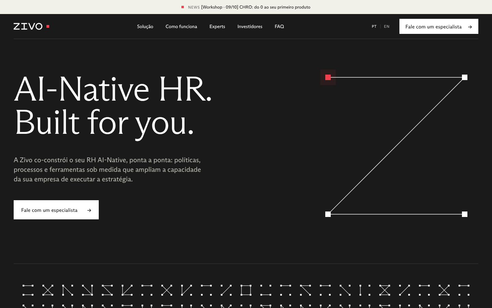
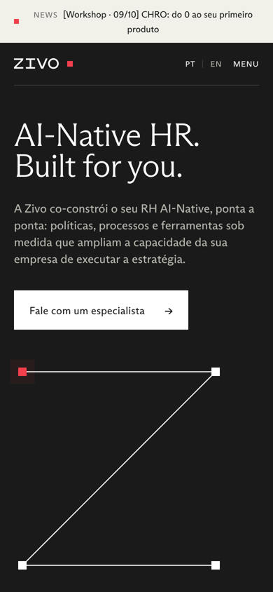

# Zivo — Homepage

Estudo de homepage para a Zivo (rebranding de Comp → Zivo), em **React Native** com Expo e `react-native-web`.
O mesmo código roda na web (desktop, tablet e mobile), iOS e Android.

| Desktop | Mobile |
| --- | --- |
|  |  |

## Como rodar

Requisitos: Node 20+ e as fontes da marca em `assets/fonts` (veja [assets/fonts/README.md](assets/fonts/README.md)).

```bash
npm install
npm run web          # http://localhost:8081
npm run export:web   # build estático em /dist
npm run ios          # ou: npm run android
```

## Estrutura

```
App.tsx                      composição da página, header fixo e rolagem por âncora
src/theme.ts                 tokens da marca: cores, fontes, breakpoints, regra Light/Regular
src/fonts.ts                 registro das fontes ABC Arizona
src/i18n/content.ts          textos em PT-BR (fiéis à home atual, Comp → Zivo) e EN
src/hooks/useBreakpoint.ts   mobile < 768 · tablet ≥ 768 · desktop ≥ 1100
src/graphics/                Wordmark (vetor), ZPath (Z animado), GlyphField (campo de glifos)
src/components/ui.tsx        Txt (escala tipográfica), Section, MetaBar, Button, ImageSlot…
src/sections/                Header, Hero, Body1 (01–05 + CTA), Body2 (06–09 + rodapé)
```

## Sistema visual

Referência: deck "ZIVO — Design review 10.08.26".

- **Cores:** Ink `#1A1A1A` (50%) · White (25%) · Off-white `#F1F1EA` (20%) · Red `#F43F4C` (5%). O vermelho é só acento e marca a empresa: um nó vermelho por composição.
- **Forma gráfica:** pontos quadrados conectados por linhas finas, formando o **Z** (hero, campo de glifos, passos e pilares).
- **Estrutura:** hairlines de 1px, barra de meta (Zivo · seção · nº) em cada bloco e muito respiro.
- **Tipografia:** ABC Arizona Flare nos títulos e ABC Arizona Sans no texto. A Flare usa o corte **Light acima de 24px** e **Regular em 24px ou menos**.

## Estrutura da página

Banner · Hero · Depoimentos de CHROs · O problema · Solução · Clientes (150+) · Como funciona · CTA do plano · Experts · Investidores · Na mídia · FAQ · CTA final · Rodapé.

## Pendências

1. **Fotografia:** os `ImageSlot` aguardam as fotos aéreas do sistema. Passe `source={...}`; no web a imagem vira P&B automaticamente.
2. **Logos de clientes** (grade 150+) e **vídeos de depoimento** dos CHROs: placeholders.
3. **FAQ:** o site atual não expõe as respostas, então os acordeões mostram um aviso.
4. **Wordmark:** redesenhado em vetor a partir da capa do deck. Substituir pelo SVG oficial.
5. **Links externos** ainda apontam para comp.vc (agendamento e matérias).
6. A citação de Keith Rabois usa "[Zivo]" no lugar de "Comp"; confirmar com o cliente.
